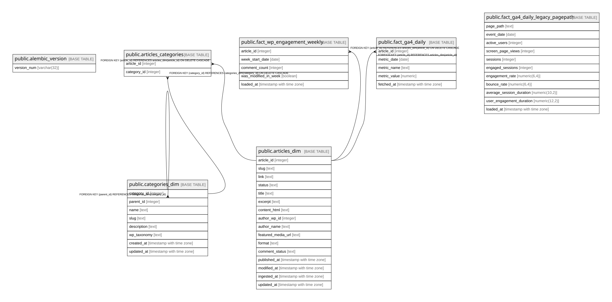

# taxidrivers

## Tables

| Name | Columns | Comment | Type |
| ---- | ------- | ------- | ---- |
| [public.alembic_version](public.alembic_version.md) | 1 |  | BASE TABLE |
| [public.categories_dim](public.categories_dim.md) | 8 | Dimension: categorie e tassonomie custom WordPress, gerarchia via parent_id (adjacency list) | BASE TABLE |
| [public.articles_dim](public.articles_dim.md) | 16 | Dimension: un articolo = una riga, attributi descrittivi stabili. Le metriche di performance vivono nelle fact table separate. | BASE TABLE |
| [public.articles_categories](public.articles_categories.md) | 2 | Bridge many-to-many tra articles_dim e categories_dim | BASE TABLE |
| [public.fact_wp_engagement_weekly](public.fact_wp_engagement_weekly.md) | 5 | Fact table grain settimanale: metriche di engagement native WP REST API (commenti, flag modifica). Grain diverso da fact_ga4_daily/fact_gsc_daily (giornaliere). | BASE TABLE |
| [public.fact_ga4_daily_legacy_pagepath](public.fact_ga4_daily_legacy_pagepath.md) | 11 | Archivio della fact_ga4_daily pre-restyling (0003): formato wide, grain (page_path, event_date), otto colonne metriche fisse. I dati qui presenti non vengono piu' aggiornati: il backfill dei record risolvibili via slug e' gia' stato eseguito nella nuova fact_ga4_daily (formato long, grain per article_id). Usare questa tabella solo per diagnostica o recupero storico. | BASE TABLE |
| [public.fact_ga4_daily](public.fact_ga4_daily.md) | 5 | Fact table GA4 in formato long: una riga per (article_id, metric_date, metric_name). Grain rigorosamente giornaliero: metric_date e' una singola DATE, non un intervallo. Strutturalmente impossibile memorizzare una misurazione su piu' di un giorno. Scritture idempotenti via INSERT ... ON CONFLICT (article_id, metric_date, metric_name) DO UPDATE. | BASE TABLE |

## Relations

---

> Generated by [tbls](https://github.com/k1LoW/tbls)
