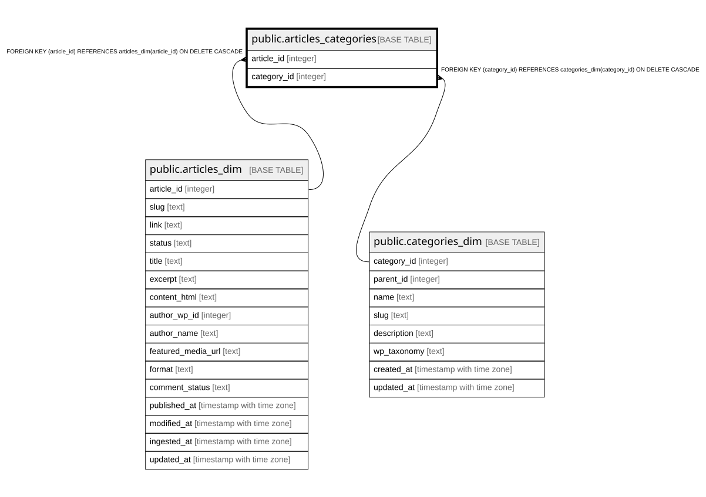

# public.articles_categories

## Description

Bridge many-to-many tra articles_dim e categories_dim

## Columns

| Name | Type | Default | Nullable | Children | Parents | Comment |
| ---- | ---- | ------- | -------- | -------- | ------- | ------- |
| article_id | integer |  | false |  | [public.articles_dim](public.articles_dim.md) |  |
| category_id | integer |  | false |  | [public.categories_dim](public.categories_dim.md) |  |

## Constraints

| Name | Type | Definition |
| ---- | ---- | ---------- |
| articles_categories_category_id_fkey | FOREIGN KEY | FOREIGN KEY (category_id) REFERENCES categories_dim(category_id) ON DELETE CASCADE |
| articles_categories_article_id_fkey | FOREIGN KEY | FOREIGN KEY (article_id) REFERENCES articles_dim(article_id) ON DELETE CASCADE |
| articles_categories_pkey | PRIMARY KEY | PRIMARY KEY (article_id, category_id) |

## Indexes

| Name | Definition |
| ---- | ---------- |
| articles_categories_pkey | CREATE UNIQUE INDEX articles_categories_pkey ON public.articles_categories USING btree (article_id, category_id) |
| idx_articles_categories_category | CREATE INDEX idx_articles_categories_category ON public.articles_categories USING btree (category_id) |

## Relations

---

> Generated by [tbls](https://github.com/k1LoW/tbls)
