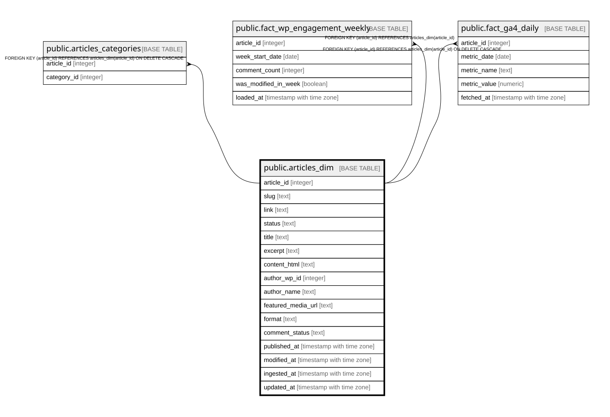

# public.articles_dim

## Description

Dimension: un articolo = una riga, attributi descrittivi stabili. Le metriche di performance vivono nelle fact table separate.

## Columns

| Name | Type | Default | Nullable | Children | Parents | Comment |
| ---- | ---- | ------- | -------- | -------- | ------- | ------- |
| article_id | integer |  | false | [public.articles_categories](public.articles_categories.md) [public.fact_wp_engagement_weekly](public.fact_wp_engagement_weekly.md) [public.fact_ga4_daily](public.fact_ga4_daily.md) |  |  |
| slug | text |  | false |  |  |  |
| link | text |  | false |  |  |  |
| status | text | 'publish'::text | false |  |  |  |
| title | text |  | false |  |  |  |
| excerpt | text |  | true |  |  |  |
| content_html | text |  | true |  |  | content.rendered integrale, serve da input per feature engineering testuale (word count, NLP) |
| author_wp_id | integer |  | true |  |  | ID autore WordPress, denormalizzato: nessuna tabella authors dedicata per scelta di semplicita e privacy |
| author_name | text |  | true |  |  |  |
| featured_media_url | text |  | true |  |  |  |
| format | text |  | true |  |  |  |
| comment_status | text |  | true |  |  |  |
| published_at | timestamp with time zone |  | true |  |  |  |
| modified_at | timestamp with time zone |  | true |  |  |  |
| ingested_at | timestamp with time zone | now() | false |  |  |  |
| updated_at | timestamp with time zone | now() | false |  |  |  |

## Constraints

| Name | Type | Definition |
| ---- | ---- | ---------- |
| articles_dim_pkey | PRIMARY KEY | PRIMARY KEY (article_id) |
| articles_dim_slug_key | UNIQUE | UNIQUE (slug) |

## Indexes

| Name | Definition |
| ---- | ---------- |
| articles_dim_pkey | CREATE UNIQUE INDEX articles_dim_pkey ON public.articles_dim USING btree (article_id) |
| articles_dim_slug_key | CREATE UNIQUE INDEX articles_dim_slug_key ON public.articles_dim USING btree (slug) |
| idx_articles_dim_published_at | CREATE INDEX idx_articles_dim_published_at ON public.articles_dim USING btree (published_at) |
| idx_articles_dim_author | CREATE INDEX idx_articles_dim_author ON public.articles_dim USING btree (author_wp_id) |
| idx_articles_dim_status | CREATE INDEX idx_articles_dim_status ON public.articles_dim USING btree (status) |

## Relations

---

> Generated by [tbls](https://github.com/k1LoW/tbls)
