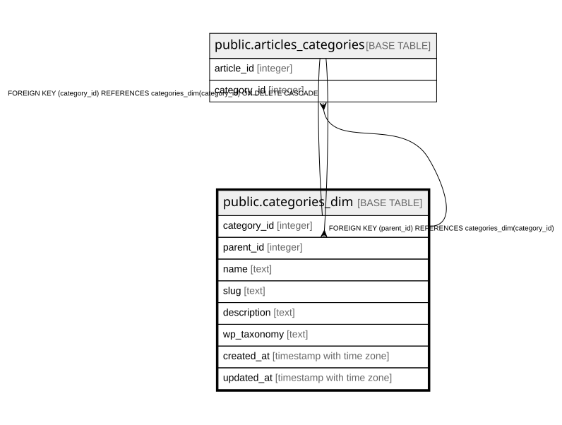

# public.categories_dim

## Description

Dimension: categorie e tassonomie custom WordPress, gerarchia via parent_id (adjacency list)

## Columns

| Name | Type | Default | Nullable | Children | Parents | Comment |
| ---- | ---- | ------- | -------- | -------- | ------- | ------- |
| category_id | integer |  | false | [public.categories_dim](public.categories_dim.md) [public.articles_categories](public.articles_categories.md) |  |  |
| parent_id | integer |  | true |  | [public.categories_dim](public.categories_dim.md) |  |
| name | text |  | false |  |  |  |
| slug | text |  | false |  |  |  |
| description | text |  | true |  |  |  |
| wp_taxonomy | text | 'category'::text | false |  |  | Distingue category standard da tassonomie custom (Recensioni, Serie TV, Festival...), da confermare via /wp/v2/taxonomies |
| created_at | timestamp with time zone | now() | false |  |  |  |
| updated_at | timestamp with time zone | now() | false |  |  |  |

## Constraints

| Name | Type | Definition |
| ---- | ---- | ---------- |
| categories_dim_parent_id_fkey | FOREIGN KEY | FOREIGN KEY (parent_id) REFERENCES categories_dim(category_id) |
| categories_dim_pkey | PRIMARY KEY | PRIMARY KEY (category_id) |
| categories_dim_slug_key | UNIQUE | UNIQUE (slug) |

## Indexes

| Name | Definition |
| ---- | ---------- |
| categories_dim_pkey | CREATE UNIQUE INDEX categories_dim_pkey ON public.categories_dim USING btree (category_id) |
| categories_dim_slug_key | CREATE UNIQUE INDEX categories_dim_slug_key ON public.categories_dim USING btree (slug) |
| idx_categories_dim_parent | CREATE INDEX idx_categories_dim_parent ON public.categories_dim USING btree (parent_id) |
| idx_categories_dim_taxonomy | CREATE INDEX idx_categories_dim_taxonomy ON public.categories_dim USING btree (wp_taxonomy) |

## Relations

---

> Generated by [tbls](https://github.com/k1LoW/tbls)
