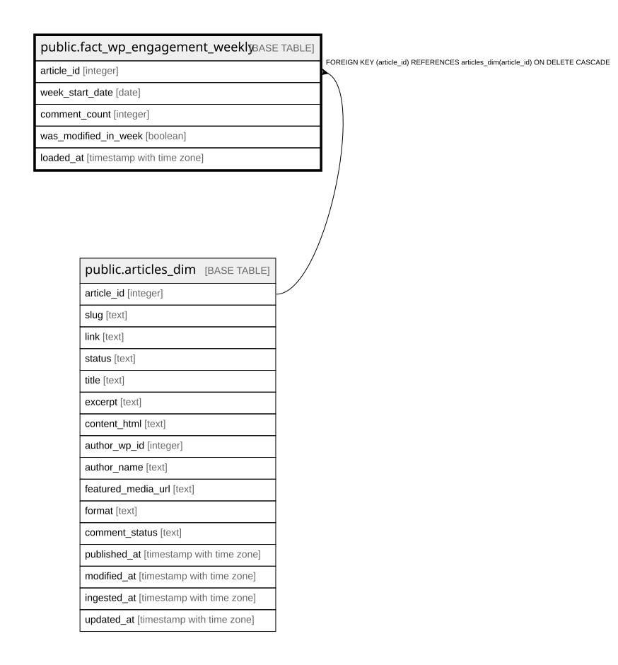

# public.fact_wp_engagement_weekly

## Description

Fact table grain settimanale: metriche di engagement native WP REST API (commenti, flag modifica). Grain diverso da fact_ga4_daily/fact_gsc_daily (giornaliere).

## Columns

| Name | Type | Default | Nullable | Children | Parents | Comment |
| ---- | ---- | ------- | -------- | -------- | ------- | ------- |
| article_id | integer |  | false |  | [public.articles_dim](public.articles_dim.md) |  |
| week_start_date | date |  | false |  |  | Lunedi della settimana ISO di riferimento, usato come chiave temporale al posto di una data singola |
| comment_count | integer | 0 | false |  |  |  |
| was_modified_in_week | boolean | false | false |  |  |  |
| loaded_at | timestamp with time zone | now() | false |  |  |  |

## Constraints

| Name | Type | Definition |
| ---- | ---- | ---------- |
| fact_wp_engagement_weekly_article_id_fkey | FOREIGN KEY | FOREIGN KEY (article_id) REFERENCES articles_dim(article_id) ON DELETE CASCADE |
| fact_wp_engagement_weekly_pkey | PRIMARY KEY | PRIMARY KEY (article_id, week_start_date) |

## Indexes

| Name | Definition |
| ---- | ---------- |
| fact_wp_engagement_weekly_pkey | CREATE UNIQUE INDEX fact_wp_engagement_weekly_pkey ON public.fact_wp_engagement_weekly USING btree (article_id, week_start_date) |
| idx_fact_wp_engagement_weekly_week | CREATE INDEX idx_fact_wp_engagement_weekly_week ON public.fact_wp_engagement_weekly USING btree (week_start_date) |

## Relations

---

> Generated by [tbls](https://github.com/k1LoW/tbls)
